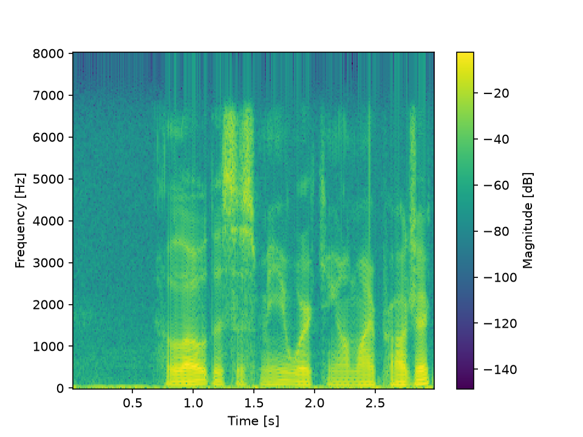

# Jarvis Voice

**Is a speaker verification model able to recognize me no matter which language I'm speaking?**

I speak English, Swedish, and Spanish, and I'm currently learning Mandarin. This project aims to build a 'Jarvis-esque' voice recognition system and use it to test if a learned voiceprint survives switching languages, or whether the model gets distracted by what I’m saying instead of who is saying it.

> Work in progress: currently building the audio feature pipeline.

## Progress

- [x] Record and load audio (converted to mono, resampled to 16 kHz)
- [x] Short-time Fourier transform written from scratch in NumPy (framing, Hamming window,
      FFT, dB scale), verified against `scipy.signal.stft`
- [x] Mel spectrograms
- [ ] Train a speaker embedding model in PyTorch on a public multi-speaker dataset
- [ ] Cross-language experiment: enroll in one language, verify in the others
- [ ] Attack the system: replay and voice-clone attacks, plus a random-phrase defense

## How it works (this far)

audio → 16 kHz mono → STFT (25 ms frames, 10 ms hop) → mel filterbank (64 bands) → dB

## Setup

Requires Python 3.14+ and the PortAudio system library
(Arch: `sudo pacman -S portaudio`, Ubuntu: `sudo apt install libportaudio2`).

    git clone https://github.com/JuliusMard/jarvis-voice.git
    cd jarvis-voice
    python -m venv .venv
    source .venv/bin/activate
    pip install -r requirements.txt
    python main.py

## Project structure

- `main.py`: recording, loading, STFT, mel spectrogram and plotting
- `compare_stft.py`: checks my STFT implementation against SciPy's

## Privacy

Voice recordings are never committed to this repository and never should be (see `.gitignore`).